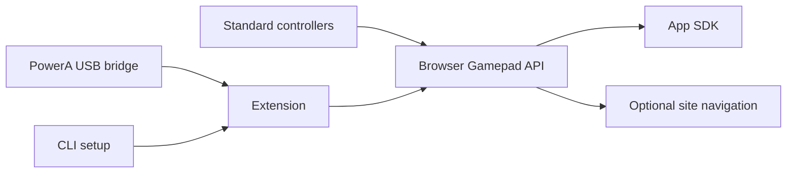

# Padkit

A local controller toolkit: browser extension, setup CLI, shared input core and embeddable SDK. Early development release; nothing is published to npm.



## Test setup

Requires Node 20+; browser/profile discovery currently targets macOS. No npm install is required.

```sh
node packages/cli/index.js browsers
node packages/cli/index.js setup
node packages/cli/index.js doctor
```

For the existing PowerA and Arc setup, an explicit example is:

```sh
node packages/cli/index.js setup --browser arc --profile Default --site https://crescendo.firstroboticsim.com --preset gamepad --powera
```

In the selected browser profile, open `chrome://extensions`, turn on Developer mode, choose **Load unpacked**, and select the folder printed by setup. Refresh the target site. The CLI prepares configuration; installing the unpacked extension is a manual browser step. It does not open browsers, modify profiles or silently install extensions.

This release preserves the old PowerA extension's public key/ID for compatibility with its native host. Remove the old extension from that profile before loading Padkit; never keep both active. Its old extension folder and shared USB service are preserved. To roll back, remove Padkit and load the previous extension folder again.

Use `--profile 'Profile 2'` for another profile. Run `browsers` to see directory names. Chrome, Arc and Dia use the same extension bundle, but browser behavior and native-host discovery still require manual verification. Dia discovery was observed locally; end-to-end Dia input is not yet verified.

```sh
node packages/cli/index.js add https://reefscape.firstroboticsim.com --browser arc
node packages/cli/index.js remove https://reefscape.firstroboticsim.com --browser arc
node packages/cli/index.js status
node packages/cli/index.js uninstall --browser arc
```

After changes, Reload Padkit on the extensions page and refresh affected tabs. Exact origins are enabled, including scheme and port; adding one subdomain does not enable its siblings. The preset applies to all configured sites in that browser/profile. Configurations are stored in `.local/`, excluded from Git. Set `PADKIT_HOME` to override this directory.

## Presets and controllers

- `gamepad`: preserves the website's own gamepad behavior; optionally exposes the PowerA bridge as a standard gamepad. Recommended for simulators.
- `navigation`: standard-controller D-pad up/down scrolls, left/right moves focus, and the south face button activates the focused element. Text fields suppress these navigation actions. Only the visible, focused document acts on input.

Standard controllers use the browser Gamepad API, with no vendor-name filtering. Actual device support depends on the OS and browser. Nonstandard devices can be remapped through SDK calibration; automatic device identification and a calibration UI are not included. Vibration capability is reported, but rumble output is not implemented.

The optional native backend retains the previously working PowerA FUSION Pro 2 USB reader (`20d6:4001`). `--powera` uses the existing shared reader and `local.powera.browser` host registration. It does not install that service on a fresh machine. `doctor` checks file presence, not live hardware. Source for the native backend is preserved under `native/src`; no app/game launch modifications are included.

## Developer SDK

Import from `packages/sdk/index.js`, or install this private repository as a Git dependency. The package exports the SDK at its root and normalization helpers at `/core`. The SDK uses browser globals only when initialized.

```js
import { createController } from '@simonstoryparker/padkit';
const controller = createController({
  bindings: { confirm: 0, pause: 9 },
  onAction({ action, phase }) { console.log(action, phase); },
  onFrame(pads) { /* normalized analog and digital states */ },
  calibration: {
    'your device id': { threshold: 0.12, axes: [0, 1, 2, 3], buttons: [0, 1, 2, 3] }
  }
});
// Call on component unmount:
controller.dispose();
```

Initialize after the document root exists. One action runtime is allowed per window; a second initialization throws instead of silently creating duplicate callbacks. Buttons emit press/release edges. Disconnect, loss of focus and disposal release active actions. Nonstandard input mapping is opt-in; configure the full button/axis index list when remapping.

An app that already owns its input loop can call `claimControllerSupport()` and retain its returned cleanup function. Use `{ source: 'native' }` only when the app supplies its own native controller reader. Normal SDK ownership suppresses extension navigation while preserving the optional bridge as an input source; native ownership suppresses the bridge too. Reference-counted claims handle overlapping component lifetimes. The DOM marker is a cooperation mechanism, not a security boundary or detector for unrelated third-party controller libraries.

## SDK and handoff test

From this repository:

```sh
python3 -m http.server 8765 --bind 127.0.0.1
```

Open `http://127.0.0.1:8765/examples/sdk.html`. Enable that exact origin with the CLI to test simultaneous extension/SDK use. The extension popup should report **Handled by this app**. Pressing **Release SDK ownership** hands navigation back to the extension when using its navigation preset.

## Verification

```sh
npm test
sh native/build.sh
python3 native/tests/test-native.py
```

Automated checks cover action edges/disconnect, calibration, SDK claim lifecycle, duplicate initialization, profile-scoped setup/update/removal, permission URL validation, virtual gamepad coexistence, malformed frames and native message framing/origin rejection. Physical controller behavior and browser installation need a manual test. Simulation Studio has not been modified.
